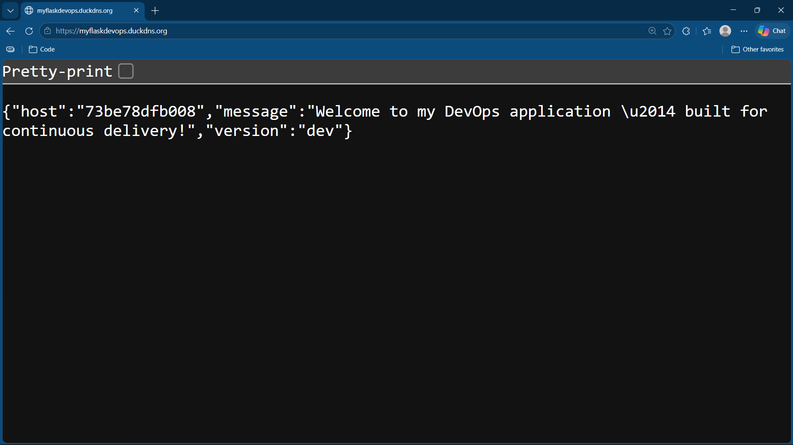
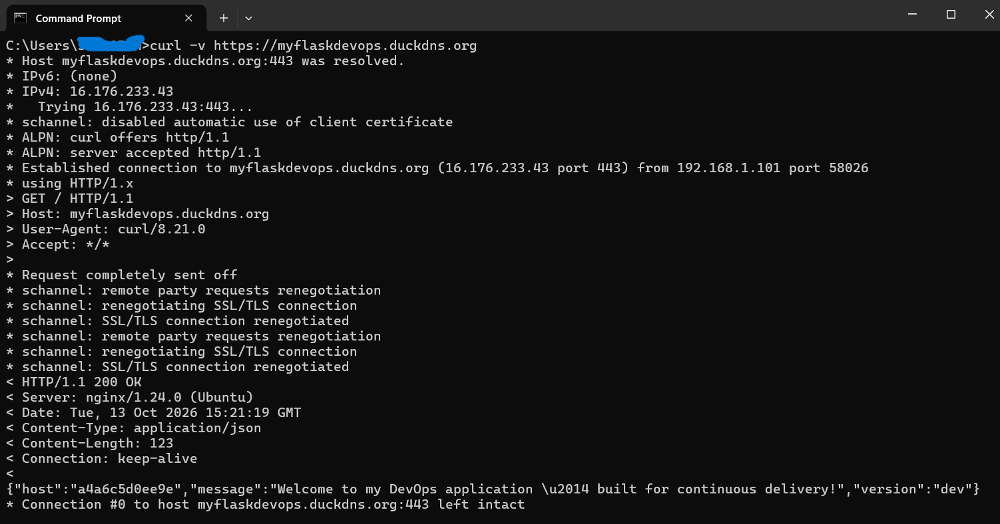
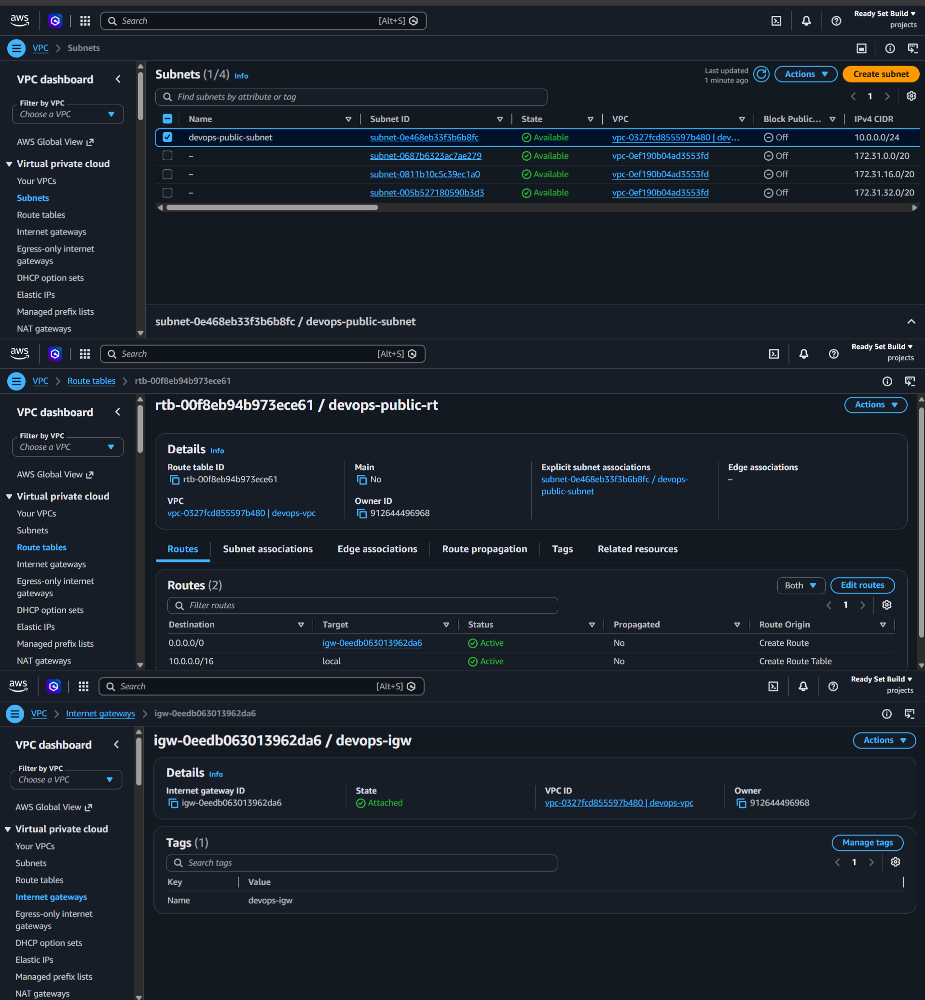
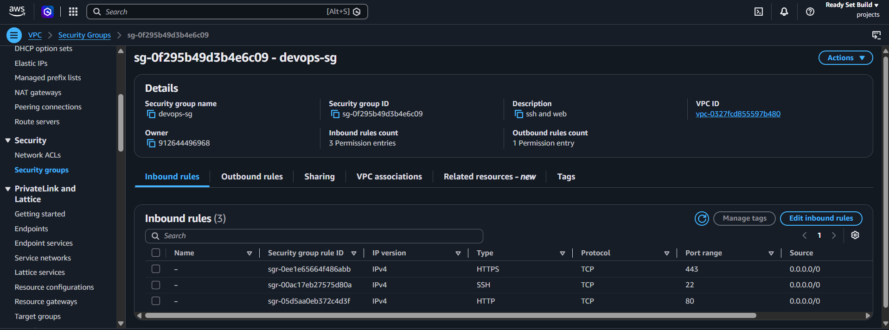
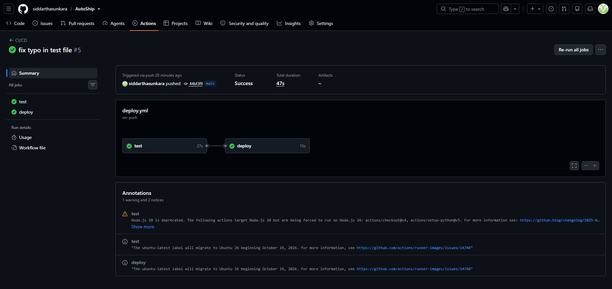
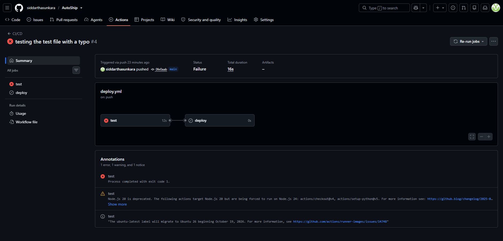

# DevOps Project: Flask App on AWS

Demo: screenshots are below. The environment was torn down to avoid cost; everything needed to rebuild it is in this repo.

## Architecture
Internet -> Security Group (22/80/443) -> VPC 10.0.0.0/16
  -> Public subnet 10.0.1.0/24 -> EC2 (Ubuntu 24.04)
     -> nginx (TLS, :443) -> Docker container (gunicorn, :5000)

## What it does
A small Flask app deployed automatically on every push.

## Pipeline
Push to main -> run tests -> build image -> SSH deploy -> health check

## Security decisions
- Custom VPC, only ports 22/80/443 open
- App bound to localhost, reachable only via nginx
- HTTPS via Let's Encrypt with auto-renewal
- Secrets in GitHub Secrets, no keys in the repo
- Known tradeoff: SSH open to the internet so GitHub runners can deploy
  (key-only auth). Production alternative: AWS SSM or a temporary rule.

## What I broke and how I fixed it
I broke each layer of the stack on purpose to learn what its failure looks like and how to isolate it. The method each time: work out which layer failed (app, network, TLS, or pipeline) by testing from inside the server versus outside.

### 1. App container stopped
- **Break:** `docker stop autoship`
- **Symptom:** The site returned **502 Bad Gateway**, not a timeout.
- **What it told me:** nginx was alive but its backend was dead.
- **Diagnosis:** `docker ps -a` showed the container as exited. `sudo tail /var/log/nginx/error.log` showed nginx failing to connect to 127.0.0.1:5000.
- **Fix:** `docker start autoship`

### 2. Firewall rule removed
- **Break:** Deleted the HTTPS (443) inbound rule from the security group.
- **Symptom:** From my laptop the request **timed out** with no response.
- **Diagnosis:** Running `curl -k https://localhost` on the server still worked, which proved the app and nginx were healthy and the problem was the network layer.
- **Fix:** Re-added the HTTPS inbound rule.

### 3. Broken nginx config
- **Break:** Introduced a typo in the server block.
- **Symptom:** `sudo nginx -t` failed and reported the file and line number.
- **Fix:** Corrected the typo and re-ran `nginx -t` before reloading. Lesson: always test the config before reloading.

### 4. Failing test blocked deployment
- **Break:** Changed an assertion in `test_app.py` to a wrong value and pushed.
- **Symptom:** The `test` job went red and the `deploy` job never ran.
- **What it told me:** `needs: test` protects the live server from untested code.
- **Diagnosis:** Opened the failed step in the Actions log and read the pytest output (expected vs actual).
- **Fix:** Restored the correct assertion and pushed.

### 5. Wrong SSH key in GitHub Secrets
- **Break:** Replaced the `EC2_SSH_KEY` secret with an invalid value and re-ran the workflow.
- **Symptom:** Tests passed but the deploy step failed with an SSH authentication error.
- **Diagnosis:** The failure was in the deploy step only, which pointed to credentials rather than code.
- **Fix:** Restored the correct key in the secret and re-ran.

### 6. Inspecting the TLS certificate
- **Check:** `echo | openssl s_client -connect <domain>:443 2>/dev/null | openssl x509 -noout -dates`
- **Result:** Certificate valid from `<start date>` to `<expiry date>` (Let's Encrypt, 90-day validity).
- **Also confirmed:** `certbot renew --dry-run` succeeded, so auto-renewal works.

### 7. Invalid workflow YAML
- **Break:** Broke the indentation in `deploy.yml` and pushed.
- **Symptom:** The workflow failed immediately, before any step ran.
- **What it told me:** A parse error fails at the workflow level, not at runtime.
- **Fix:** Corrected the indentation.

### What I took away
- 502 means the proxy is up and the app is down. A timeout means traffic isn't reaching the server at all.
- Testing from inside the server versus from outside quickly separates app problems from network problems.
- `needs:` and the post-deploy health check keep broken code from being reported as a successful deploy.

## Limits and next steps
Single instance, no monitoring or autoscaling. Next: Terraform for the infrastructure.
